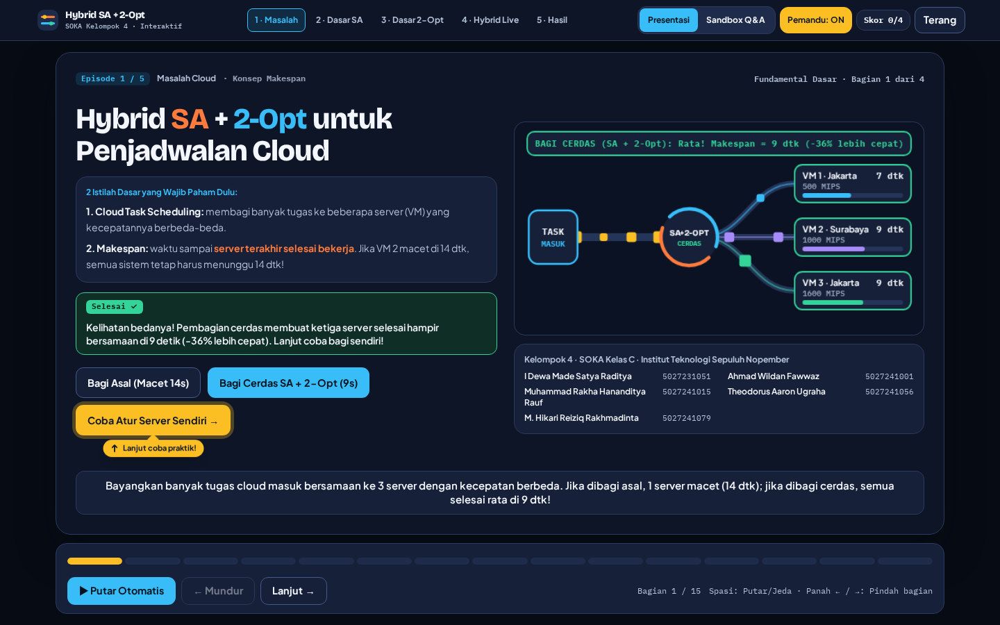
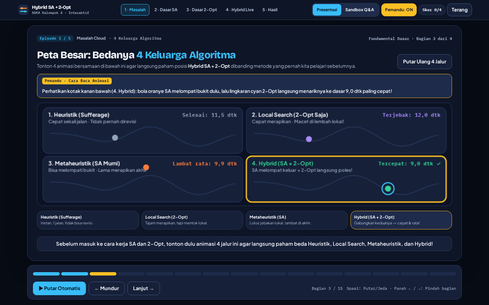
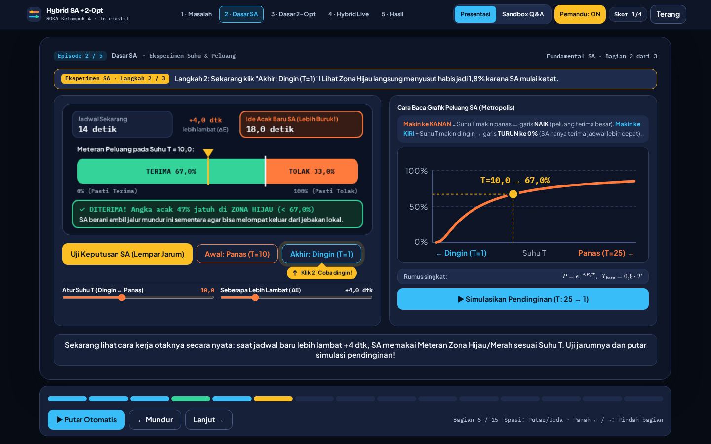
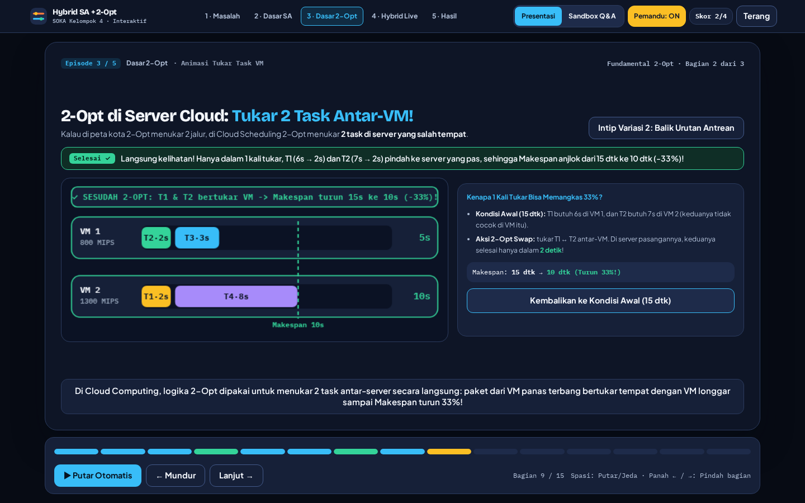
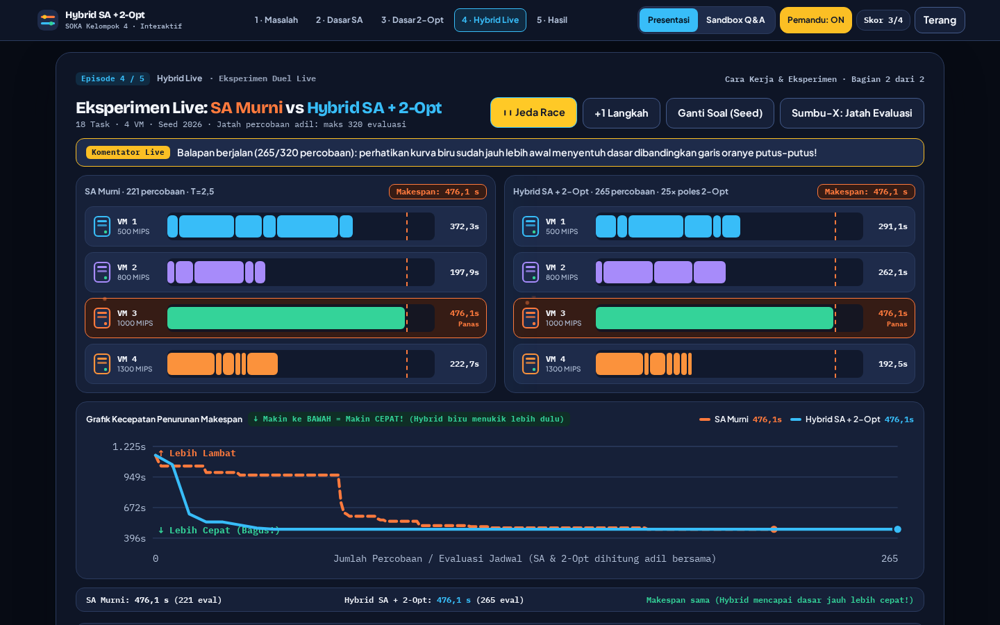
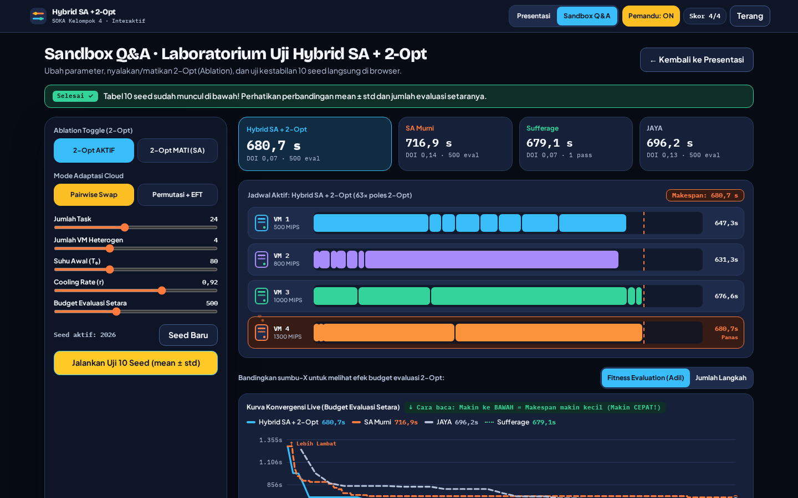

# Hybrid Simulated Annealing + 2-Opt · Presentasi Animasi Interaktif SOKA

[](https://hikarireiziq.github.io/Hybrid_SA_OPT/)
[](https://vitejs.dev/)
[](https://vitest.dev/)

Website edukasi dan presentasi animasi interaktif untuk mata kuliah **Strategi Optimasi Komputasi Awan (SOKA)**, **Kelompok 4 · Kelas C · Departemen Teknologi Informasi, Institut Teknologi Sepuluh Nopember (ITS)**.

> **Buka Live Website:** https://hikarireiziq.github.io/Hybrid_SA_OPT/

---

## Tentang Repository Ini

Repository ini dibangun khusus untuk menjelaskan cara kerja algoritma **Hybrid Simulated Annealing + 2-Opt** pada permasalahan **Cloud Task Scheduling** dengan bahasa sehari-hari, animasi bergerak 60fps, pemandu kursor langkah demi langkah, dan eksperimen langsung di browser. Tujuannya agar pendengar IT yang belum pernah belajar optimasi komputasi awan bisa memahami fundamentalnya dari nol sebelum melihat perbandingan hasil eksperimen.

### Konteks Tugas SOKA (Kelompok 4)
Proyek ini melanjutkan rangkaian eksperimen kelompok kami pada mata kuliah SOKA:
1. **Desain Datacenter & Dataset**: Simulasi cloud heterogen **DC Jakarta & DC Surabaya** (profil VM `500-1600 MIPS`) dengan dataset **GoCJ** dan **NASA Ames** menggunakan CloudSim.
2. **Baseline Sebelumnya**: Implementasi heuristik **Sufferage** (simulator & real-world Kubernetes) serta metaheuristik **JAYA** dan **Simulated Annealing (SA Murni)**.
3. **Tugas Hybrid Algorithm**: Memilih 2 algoritma hybrid dari jurnal ilmiah (**Simulated Annealing + 2-Opt** sebagai algoritma utama yang dipresentasikan, serta **Discrete JAYA + 2-Opt** sebagai pembanding), lalu membandingkannya secara adil melawan metode sebelumnya.

### Mengapa Hybrid SA + 2-Opt?
- **SA Murni** sudah unggul di sebagian besar skenario GoCJ kelompok kami, tetapi masih meninggalkan ketimpangan beban antar-VM (`DOI = 0,43` pada 1000 task) dan variansi tinggi di beban NASA (`±66.963 s`).
- **2-Opt** sangat cepat merapikan beban timpang dengan menukar pasangan task antar-server, tetapi mudah terjebak di *local optimum* jika berjalan sendirian.
- **Hybrid SA + 2-Opt** (pola **Low-level Relay Hybrid / LRH**, merujuk *Gunawan & Iryanto, 2023*) memanggil 2-Opt langsung di dalam setiap putaran SA: SA menjelajah luas melewati bukit *local optimum*, sedangkan 2-Opt langsung memoles jadwal agar cepat rata dan stabil.

---

## Galeri Tangkapan Layar

### 1. Pembuka Interaktif: Bagi Asal (Macet 14 dtk) vs Bagi Cerdas SA + 2-Opt (Rata 9 dtk)
Animasi 60fps memperlihatkan aliran paket task ke 3 server DC Jakarta & Surabaya sehingga konsep *Cloud Task Scheduling* dan *Makespan* langsung dipahami sejak layar pertama.



### 2. Peta Besar 4 Keluarga Algoritma (Animasi 4 Jalur Paralel)
Membandingkan gerak **Heuristik (Sufferage)**, **Local Search (2-Opt)**, **Metaheuristik (SA Murni)**, dan **Hybrid (SA + 2-Opt)** secara bersamaan pada lanskap pencarian yang sama.



### 3. Eksperimen Fundamental SA: Meteran Zona Hijau/Merah + Cara Baca Grafik
Menerjemahkan rumus probabilitas Metropolis (`P = exp(-ΔE/T)`) menjadi skenario jadwal konkret (`14 dtk → 18 dtk`), meteran peluang zona **TERIMA (Hijau)** vs **TOLAK (Merah)** dengan jarum acak animasi, serta simulasi animasi pendinginan di kurva.



### 4. Animasi 60fps 2-Opt di Server Cloud: Tukar 2 Task Antar-VM (`15 dtk → 10 dtk`)
Memperlihatkan balok task `T1` dan `T2` benar-benar terbang bertukar server antara VM 1 dan VM 2 sehingga Makespan langsung turun 33% hanya dalam 1 kali tukar.



### 5. Eksperimen Duel Live: SA Murni vs Hybrid SA + 2-Opt (Jatah Evaluasi Adil)
Menjalankan kedua algoritma secara live pada beban, seed, dan jatah percobaan yang persis sama, dilengkapi sinar pemindai cyan 2-Opt, panduan **Cara Baca Grafik**, dan **Komentator Live**.



### 6. Sandbox Q&A: Laboratorium Eksperimen Bebas & Uji 10 Seed
Untuk sesi tanya jawab: mengubah jumlah task, jumlah VM, suhu awal `T0`, cooling rate `r`, saklar **Ablation ON/OFF 2-Opt**, mode adaptasi Cloud (*Pairwise Swap* vs *Permutasi + EFT*), serta **Uji Stabilitas 10 Seed (`mean ± std`)**.



---

## Peta Alur Presentasi (5 Episode · 15 Bagian · 7 Animasi 60fps · 4 Cek Paham)

Website menyediakan **2 mode fokus** tanpa duplikasi: **Presentasi** (layar teater widescreen dengan tombol `▶ Putar Otomatis / ❚❚ Jeda`, scrubber bab bertanda *Cek Paham*, dan pintasan keyboard `←`, `→`, `Spasi`) serta **Sandbox Q&A** untuk sesi tanya jawab. Kuis diletakkan **di sela-sela materi** untuk memastikan pemahaman fundamental sebelum berpindah ke topik berikutnya.

| Episode | Fokus Fundamental | Animasi 60fps & Eksperimen | Cek Paham (Sela Materi) |
| --- | --- | --- | --- |
| **Ep 1 · Masalah Cloud** | Arti *Cloud Task Scheduling*, *Makespan*, dan beda 4 keluarga algoritma | `CloudFactoryCanvas` (Bagi Asal vs Cerdas), Papan Dispatch 6 Task × 3 VM, `ParadigmRaceCanvas` (4 jalur paralel) | **Cek Paham 1/4**: Menghitung nilai Makespan |
| **Ep 2 · Dasar SA** | Kenapa SA berani mundur sementara, peran Suhu `T`, dan pendinginan bertahap | `SaMountainPhysicsCanvas` (+ termometer Suhu `T` live), `MetropolisDecisionCanvas` (Meteran Hijau/Merah + jarum acak + simulasi pendinginan kurva) | **Cek Paham 2/4**: Alasan SA menerima solusi lebih lambat saat panas |
| **Ep 3 · Dasar 2-Opt** | Aturan pemutusan jalur silang X dan adaptasinya ke server Cloud VM | `TwoOptMorphCanvas` (peta 4 & 8 simpul), `CloudSwapAnimCanvas` (balok `T1 ↔ T2` terbang bertukar VM + variasi urutan antrean EFT) | **Cek Paham 3/4**: Alasan 2-Opt butuh SA agar tidak macet lokal |
| **Ep 4 · Hybrid Live** | Pola **LRH** (*Gunawan & Iryanto, 2023*) dan pembuktian konvergensi adil | `LrhOrbitCanvas` (simulasi 4 tahap langkah demi langkah `18s → 11s`), Duel Live SA Murni vs Hybrid SA + 2-Opt + Komentator Live | Eksperimen langsung |
| **Ep 5 · Hasil & Penutup** | Perbandingan baseline CloudSim Kelompok 4, baca metrik `± std` & `DOI`, ringkasan | Grafik batang Sufferage / JAYA / SA Murni + Impor JSON CloudSim Hybrid tim + ringkasan 3 poin + CTA Sandbox Q&A | **Cek Paham 4/4**: Syarat perbandingan ilmiah yang adil (`Skor X/4`) |

### Fitur Pendukung Pemahaman & Presentasi
- **Pemandu Kursor Terarah (`Pemandu: ON/OFF`)**: Setiap adegan dilengkapi bilah misi langkah demi langkah dan badge panah berkait segitiga (`↓`/`↑`) yang menuntun kursor audiens tepat ke tombol atau balok task berikutnya.
- **Panduan Cara Baca Grafik**: Setiap kurva dan grafik batang menyertakan penjelasan singkat arah baca (`↓ Makin ke BAWAH = Makin CEPAT`, arti `± std`, dan arti `DOI`).
- **Midnight Theater & Daylight Studio**: Tema gelap bawaan agar animasi bercahaya menonjol, dengan tombol **Terang / Gelap** (seluruh 45 pasangan warna teruji WCAG AA `>= 4.5:1`) untuk proyektor ruang kelas terang.
- **Ramah Aksesibilitas**: Mendukung navigasi keyboard penuh, `aria-live`, dan `prefers-reduced-motion`.

---

## Arsitektur & Struktur Folder

```text
Hybrid_SA_OPT/
├── .github/workflows/deploy.yml     # CI/CD otomatis: npm test -> npm run build -> GitHub Pages
├── docs/screenshots/                # Tangkapan layar asli aplikasi untuk dokumentasi README
├── public/
│   ├── data/cloudsim-hybrid.json    # Slot bawaan data hasil simulasi CloudSim Hybrid tim
│   ├── favicon.svg
│   └── .nojekyll
└── src/
    ├── lib/algorithms/              # Mesin simulasi murni TypeScript (deterministik & teruji Vitest)
    │   ├── rng.ts                   # PRNG deterministik Mulberry32 + format angka Indonesia
    │   ├── tsp2Opt.ts               # Geometri persilangan segmen & operator 2-Opt reverse
    │   ├── cloudModel.ts            # Model VM heterogen DC Jakarta/Surabaya, ETC, Makespan/ARU/DOI
    │   ├── baselines.ts             # Brute-Force optimal, Round Robin, Sufferage, dan JAYA
    │   ├── hybridSa2Opt.ts          # Engine LRH SA + 2-Opt (Pairwise Swap & Permutasi EFT)
    │   ├── fairDuel.ts              # Duel adil budget evaluasi setara & uji batch 10 seed
    │   └── algorithms.test.ts       # 10 unit test validasi matematika algoritma
    ├── data/
    │   ├── content.ts               # Seluruh naskah 5 episode, 4 Cek Paham, & referensi ilmiah
    │   ├── kelompok4Baselines.ts    # Data baseline asli CloudSim Kelompok 4 (summary.csv)
    │   ├── cloudsimSchema.ts        # Validator runtime untuk file JSON impor hasil CloudSim tim
    │   └── cloudsimSchema.test.ts   # 2 unit test validator JSON
    ├── store/
    │   ├── presentationStore.ts     # State episode, auto-play, pemandu, tema, & skor 4 Cek Paham
    │   └── sandboxStore.ts          # State parameter eksperimen Sandbox Q&A & batch 10 seed
    └── components/
        ├── layout/                  # TopBar (2 mode fokus) & VideoTheaterShell (pemutar + scrubber)
        ├── ui/                      # 7 kanvas 60fps (AnimatedCanvases), GuidedCoach, VmRackGantt, ConvergenceSvg, QuizCard
        └── scenes/                  # Scene01 s.d. Scene05 + SandboxView
```

---

## Format Impor JSON Hasil CloudSim Tim

Untuk menjaga kejujuran ilmiah, angka CloudSim untuk **SA + 2-Opt** dan **DJAYA + 2-Opt** tidak dikarang. Di Episode 5 tersedia tombol **Impor JSON CloudSim** (dan file bawaan [public/data/cloudsim-hybrid.json](public/data/cloudsim-hybrid.json)) untuk langsung memuat hasil run Java CloudSim kelompok tanpa mengubah kode frontend:

```json
{
  "sourceLabel": "Hasil CloudSim Kelompok 4 (10 Seed, Budget Setara)",
  "isPlaceholder": false,
  "scenarios": [
    {
      "id": "tc1-1000x50",
      "dataset": "gocj",
      "tasks": 1000,
      "vms": 50,
      "evaluationBudget": 1000,
      "runs": 10,
      "results": [
        {
          "algorithm": "SA+2Opt",
          "makespanMean": 1320.4,
          "makespanStd": 18.2,
          "aruMean": 0.94,
          "doiMean": 0.19,
          "avgWaitingMean": 412.5,
          "runtimeMsMean": 980.0,
          "verifiedCloudSim": true
        }
      ]
    }
  ]
}
```

ID skenario yang dikenali secara otomatis untuk disejajarkan dengan baseline Kelompok 4: `tc1-500x50`, `tc1-1000x50`, `tc2-750x10`, dan `nasa-750x50`.

---

## Menjalankan Lokal & Pengujian

Prasyarat: **Node.js 20+** dan **npm**.

```bash
# 1. Clone repository
git clone https://github.com/HikariReiziq/Hybrid_SA_OPT.git
cd Hybrid_SA_OPT

# 2. Install dependensi
npm install

# 3. Jalankan dev server lokal (http://localhost:5173)
npm run dev

# 4. Jalankan unit test mesin algoritma & validator JSON (12 test)
npm test

# 5. Type-check & build produksi ke dist/
npm run build

# 6. Pratinjau hasil build produksi (http://localhost:4173/Hybrid_SA_OPT/)
npm run preview
```

Setiap push ke branch `main` otomatis menjalankan unit test, build produksi, dan deploy ke **GitHub Pages** melalui [.github/workflows/deploy.yml](.github/workflows/deploy.yml).

---

## Anggota Kelompok 4 · SOKA Kelas C · ITS

| Nama | NRP |
| --- | --- |
| I Dewa Made Satya Raditya | `5027231051` |
| Ahmad Wildan Fawwaz | `5027241001` |
| Muhammad Rakha Hananditya Rauf | `5027241015` |
| Theodorus Aaron Ugraha | `5027241056` |
| M. Hikari Reiziq Rakhmadinta | `5027241079` |

---

## Referensi Ilmiah Utama

1. **Hybrid Utama**: Gunawan, P. H., & Iryanto (2023). *Simulated Annealing - 2 Opt Algorithm for Solving Traveling Salesman Problem*. International Journal of Computing, 22(1), 43-50. DOI: [10.47839/ijc.22.1.2878](https://doi.org/10.47839/ijc.22.1.2878)
2. **Hybrid Pembanding**: Gündüz, M., & Aslan, M. (2021). *DJAYA: A discrete Jaya algorithm for solving traveling salesman problem*. Applied Soft Computing, 105, 107275. DOI: [10.1016/j.asoc.2021.107275](https://doi.org/10.1016/j.asoc.2021.107275)
3. **Fondasi SA & 2-Opt**: Kirkpatrick, S., Gelatt, C. D., & Vecchi, M. P. (1983). *Optimization by Simulated Annealing*. Science, 220(4598), 671-680; Croes, G. A. (1958). *A Method for Solving Traveling-Salesman Problems*. Operations Research, 6(6), 791-812.
4. **Baseline & Dataset SOKA**: Maheswaran et al. (1999) *Sufferage*; Mishra et al. (2022) *JAYA Cloud*; Celik & Dal (2021) *SA Scheduling*; Hussain & Aleem (2018) *GoCJ Dataset*.
